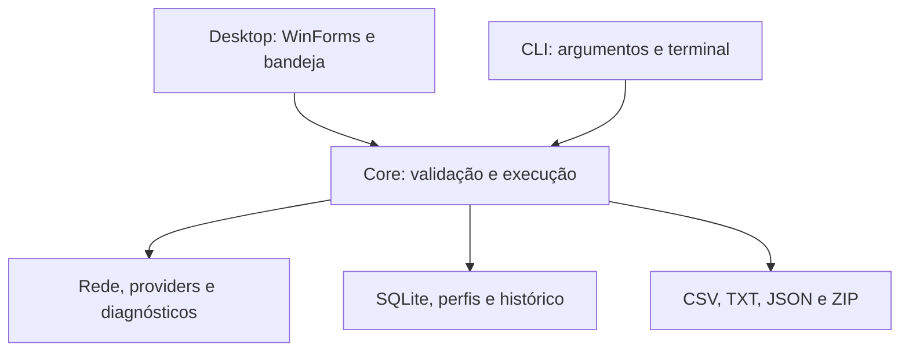

# Core, Desktop e CLI

A solução possui três projetos de produção em `src/`. Todos usam a versão de
`VERSION`, lida por `Directory.Build.props`; versão da aplicação, esquema SQLite
e formatos JSON continuam independentes.

## Limites

- **Core:** `Application`, `Models` e `Services`; providers, armazenamento, Registro,
  ACLs e preparação Windows. Alvo `net10.0-windows`, sem referência a WinForms.
- **Desktop:** inicialização STA, formulários, temas, diálogos, bandeja e composição
  gráfica. Mantém o nome `DBConnectionTester.exe`.
- **CLI:** console `dbct.exe`; parsing com System.CommandLine, handlers que chamam
  o Core, entrada de segredos, formatos de apresentação e códigos de saída.

Não há dependência entre Desktop e CLI. O Core permanece específico de Windows;
a separação não declara suporte a Linux ou macOS. Não há serviço intermediário
nem novo processo obrigatório para a interface gráfica executar diagnósticos.

## Contratos compartilhados

`TestSettingsValidator` é a entrada pública de criação das configurações imutáveis.
`ProfileSettingsMapper` transforma padrões/perfis em entrada editável antes da
validação. O Desktop não acessa setters internos do Core.

`TestRunner` recebe executor, fábrica de saída, progresso e cancelamento. Cada ciclo
é gravado antes do progresso. O Desktop apresenta o progresso no contexto WinForms;
a CLI usa apresentação síncrona para não deixar callbacks após o encerramento.

`StorageResolver` mantém os padrões da GUI. `StorageResolutionOptions` permite à CLI
desabilitar criação nas consultas e gravação da preferência. `RunRecoveryService`
centraliza a recuperação com `RunWriteLease`; o lock continua sendo compartilhado
entre executáveis. Consultas não disparam recuperação.

Os algoritmos dos diagnósticos, tabelas SQLite v1, nomes persistidos, snapshot sem
senha, relatórios e manifesto de pacote de dados v1 foram preservados. O manifesto
v1 continua aceitando no máximo um executável opcional, fornecido pelo processo
single-file atual. Os ZIPs de release Complete/CLI são uma distribuição separada.

## Testes e distribuição

A suíte existente referencia Core e Desktop; a suíte CLI referencia CLI e Core.
Testes cobrem processos reais, Ctrl+C em console oculta isolada, lock entre processos,
consulta durante execução, recuperação, segredos e formatos exportados.

O script de release preserva os três artefatos da GUI e gera Complete e CLI com
executáveis self-contained independentes. Isso duplica parte do runtime no Complete,
mas evita composição manual de dependências. A validação dos ZIPs executa a CLI em
pasta com espaços, diretório corrente diferente e lookup de runtime redirecionado;
realiza teste TCP local, consulta e exportação sem servidor externo.

MSI, suporte multiplataforma, compartilhamento otimizado de dependências, administração
de perfis pela CLI e novo manifesto de pacote de dados ficam fora desta entrega.
